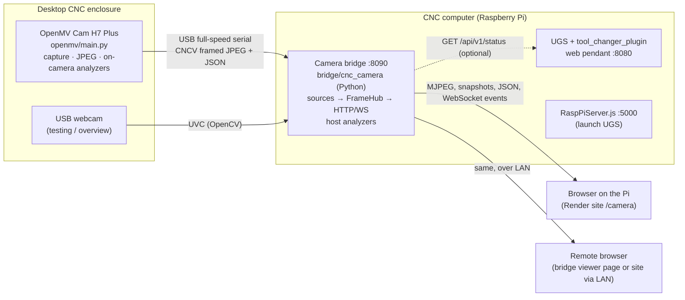

# Desktop CNC Camera System: Architecture
This page was written by Claude AI and has not been checked or rewritten yet, so take with a grain of salt

Status: v0.1 (live viewing implemented; analysis features planned)
Camera: OpenMV Cam H7 Plus (OV5640). USB webcams are supported for testing and as extra cameras.

## 1. Goals

| Goal | Status |
|---|---|
| Live view of the machine from the CNC computer and from other computers on the same network | **Done** |
| Same code path works with a USB webcam until the H7 Plus arrives | **Done** |
| Integrated into the Desktop CNC website | **Done** (`/camera` page) |
| Plug-in points for vision features (tool-break detection etc.) without re-architecting | **Done** (interfaces + example), features not built |
| Ability to stop the machine on a vision fault | Planned (section 6) |

Non-goals for now: recording/DVR, internet (off-campus) access, any write access to UGS.

## 2. System overview



Three pieces of code:

| Piece | Where it runs | Language | Location |
|---|---|---|---|
| Camera script | OpenMV H7 Plus (saved as `main.py`) | MicroPython | `openmv/main.py` |
| Camera bridge | CNC Raspberry Pi, systemd service `cnc-camera` | Python 3.11+, aiohttp, OpenCV, pyserial | `bridge/` |
| Website page | Browser (React site, `Desktop-CNC-Landing-Site`) | TypeScript/React | `src/pages/CameraPage.tsx`, `src/components/CameraFeed.tsx`, `src/services/CameraService.ts` |

**Why a separate bridge instead of putting this in the website or UGS?**
The Render-hosted site cannot reach USB hardware, and the browser cannot open serial ports reliably. UGS (Java/NetBeans) could host it, but then the camera would die every time UGS is closed and vision code would be in Java. A small Python service is independent of UGS, restarts itself, and gives us OpenCV/NumPy for analysis.

**Why Python and not Node (like `RaspPiServer.js`)?** Webcam capture and image analysis in Node need native add-ons that are painful on ARM. OpenCV-Python is one apt package on Raspberry Pi OS.

## 3. OpenMV Cam H7 Plus: what it is good and bad at

| | Detail | Consequence for us |
|---|---|---|
| CPU | STM32H743 Cortex-M7 @ 480 MHz, 1 MB SRAM + 32 MB SDRAM | Classic machine vision (thresholds, blobs, edges, line fitting, AprilTags, template matching) at QVGA runs at 25-50 fps on-camera. Small TFLite/FOMO models are possible at low res. No real deep learning. |
| Sensor | OV5640, 5 MP, removable module, M12 lens 2.8 mm (H-FOV ≈ 66°) | Wide view of the work area from close range. Fixed focus: **focus the lens by hand once mounted**, then lock it. Lens can be swapped for a narrower FOV if we want a close-up of the tool. |
| Hardware JPEG | OV5640 can output JPEG directly | Used for 5 MP stills with no RAM cost. |
| USB | **Full-speed only: 12 Mbit/s (~0.8-1 MB/s real)** | This is the main limit. VGA ≈ 20-30 fps, HD ≈ 10 fps, 5 MP is stills only. We always JPEG on the camera and pass JPEGs through the bridge untouched (zero decode/encode on the Pi). |
| IR LEDs | 2 × 850 nm high-power | Can light the tool for silhouette checks; the IR-cut filter (650 nm) blocks most of it unless the lens is swapped. |
| I/O | UART, SPI, I2C, CAN, servo/PWM pins, interrupts | A future "hard" fault line (GPIO to the controller's feed-hold input) is possible without going through USB. |
| Environment | -20 to 70 °C, lens IP4X only | **Must be protected from coolant and chips** (window + air knife or shroud). |
| Product status | Discontinued; successor is the OpenMV N6 | Buy a spare now if the project depends on it. The protocol and bridge are camera-agnostic, so an N6 (or any UVC webcam) can replace it. |
| Firmware | `sensor` module deprecated in favor of `csi` (v4.8+); v5 introduced a new host protocol | `main.py` supports both APIs. See risk R1 in section 9. |

## 4. Data path and protocol

### 4.1 Camera → bridge (USB serial)

The camera script pushes packets; the bridge never polls for frames. Full spec in `bridge/cnc_camera/protocol.py`.

```
| "CNCV" | ver u8 | type u8 | seq u16 | len u32 | payload |
types: 0x01 frame JPEG · 0x02 hi-res still · 0x10 analysis event (JSON)
       0x11 info/telemetry (JSON, every 2 s) · 0x12 log text · 0x13 command ACK (JSON)
```

Host → camera: one JSON command per line (`hello`, `set`, `stream`, `snapshot`, `led`, `ping`). Every command gets an ACK with the same `id`.

Design choices:
- **Push, not request/response:** one round-trip less per frame; USB stays saturated.
- **Self-synchronising framing:** a cable glitch or camera reboot costs one frame; the parser finds the next `CNCV`.
- **Drop, never queue:** if the host stops reading, the camera's `send` times out and the frame is dropped. Live view must show *now*.
- **Baud 115200 on the host side is deliberate.** 921600 and 12000000 are magic values that switch the OpenMV into its IDE debug protocol.
- **The camera re-applies nothing on its own;** the bridge sends the full config on every (re)connect, so the camera can be power-cycled anytime.

### 4.2 Bridge internals

```
CameraSource (thread per camera, auto-reconnect with backoff)
   webcam.py | openmv.py | testpattern.py
        │ publish_threadsafe(Frame)
        ▼
FrameHub (latest-frame fan-out, per camera)  ──►  MJPEG viewers (each throttled independently)
        │                                     ──►  AnalysisRunner → Analyzers → EventBus
        ▼
EventBus  ──►  WebSocket /api/events  (camera.status, camera.info, analysis, machine.state)
```

A slow viewer only ever gets the newest frame; it cannot slow the camera or other viewers. When a camera is offline the hub publishes a rendered "Camera offline: reason" card, so viewers see why instead of a frozen image.

### 4.3 HTTP API (port 8090)

| Method | Path | Purpose |
|---|---|---|
| GET | `/` | Standalone viewer page (works from any LAN computer) |
| GET | `/api/health` | Liveness, API version |
| GET | `/api/cameras` | All cameras + status + machine link + available analyzers |
| GET | `/api/cameras/{id}` | One camera's status |
| GET | `/api/cameras/{id}/stream.mjpg?fps=N` | Live MJPEG (``-compatible) |
| GET | `/api/cameras/{id}/snapshot.jpg[?hires=1&framesize=QXGA][&download=1]` | Latest frame or 5 MP still (OpenMV) |
| POST | `/api/cameras/{id}/command` | Camera control (OpenMV). Allowed from localhost, or from anywhere when a token is set |
| WS | `/api/events` | Live event stream |
| GET | `/api/events/recent` | Event history |

`/stream.mjpg` and `/snapshot.jpg` are aliases for the default camera.

**Why MJPEG and not WebRTC/HLS?** The OpenMV already produces JPEGs, so MJPEG costs the Pi nothing, has ~100 ms latency, needs no JavaScript player, and works in every browser including phones. Its weakness is bandwidth (~0.5-1 MB/s per VGA viewer), which is fine for a handful of viewers on a LAN. If we ever need many viewers or internet viewing, add H.264 via WebRTC (e.g. go2rtc/MediaMTX) as another output of the same FrameHub.

## 5. Remote viewing: what works where

| Viewer | How | Works? |
|---|---|---|
| Browser on the CNC Pi, Render site | `https://…onrender.com/camera` → `http://localhost:8090` | Yes. Browsers allow `http://localhost` from HTTPS pages; the bridge answers Chrome's Private Network Access preflight. |
| Other computer on same network | `http://<pi-hostname>.local:8090/` (bridge viewer) | **Yes. Recommended remote path.** |
| Other computer, site served from the Pi | `npm run dev:lan` on the Pi, browse `http://<pi>.local:3000/camera` | Yes (bridge address auto-derived from the page's host). |
| Other computer, Render site | `https://…onrender.com/camera` → `http://<pi-ip>:8090` | **No** (mixed-content blocking). The page detects this and links to the bridge viewer. |
| Off campus / different network | n/a | Not in scope. Options when needed: Tailscale (simplest, gives HTTPS via `tailscale serve`), or Cloudflare Tunnel. Both remove the mixed-content problem too. |

Network notes:
- WPI's wireless network may isolate clients from each other. If remote viewing fails while the Pi itself works, test from a wired lab computer or ask WPI IT; a lab-only switch/AP or Tailscale also solves it.
- `<hostname>.local` needs mDNS (avahi on the Pi; built into macOS/Windows 10+). Otherwise use the IP printed in the bridge log.

Security: by default anyone on the network can watch (read-only). Set `[server] token` to require `?token=…`. Camera *control* is localhost-only unless a token is configured. Nothing in the bridge can move the machine.

## 6. Planned features and how they plug in

Nothing below is implemented; the hooks are. Two places analysis can run:

| | On the OpenMV (`ANALYZERS` list in `main.py`) | On the Pi (`bridge/cnc_camera/analysis/`) |
|---|---|---|
| Input | Raw frames at full sensor rate, before JPEG | Decoded JPEG frames, rate-limited |
| Good for | Fast, simple, per-frame checks (thresholds, blobs, edges, ROI stats) | Anything needing OpenCV, history, machine state, or multiple cameras |
| Costs | Lowers stream fps; MicroPython only | Pi CPU shared with UGS; JPEG artefacts |
| Output | `EVENT` packets → `{"type":"analysis","origin":"camera",…}` | `{"type":"analysis","origin":"host",…}` |

Both produce the same event envelope, so the website and any automation treat them identically.

### 6.1 Tool-break detection (highest value)

Continuous detection while cutting is unreliable with a camera: the tool spins at 6-7k RPM (motion blur), and chips/coolant cover it. Recommended approach is a **checkpoint inspection** that reuses the team's existing tool-changer machinery:

1. Mount the camera (or a second one) so it sees the tool tip when the spindle is at a known "inspection" position, ideally against a plain backdrop (IR LEDs + backlight make a clean silhouette).
2. After each tool change, and optionally every N minutes, the G-code (or the ATC plugin's generated code) moves to the inspection position and stops the spindle, e.g. `G4 P0 (CAM-CHECK T2)`.
3. A new `GcodeStreamDHS` in `tool_changer_plugin` triggers on `CAM-CHECK`, like the existing `ATC-OPEN/CLOSE` ones, and runs a small binary/script (`cnc-camera-check --tool 2`).
4. That script calls a bridge endpoint (to add: `POST /api/inspect/tool`) which grabs a still, measures the visible tool length/profile against a reference image taken when the tool was known-good, and returns pass/fail.
5. Exit code ≠ 0 → the **existing DHS code already puts the machine in HOLD** and prints the reason in the UGS console. The failing image is saved and pushed as an `alarm` event to viewers.

This needs no change to UGS core, keeps the decision synchronous with the G-code stream, and fails safe (camera unreachable → check fails → HOLD).

Prerequisites: fixed mount, reference capture per tool (stored by tool number), consistent lighting, calibration of pixels → mm (an AprilTag on the fixture makes this automatic; the H7 does AprilTags natively).

### 6.2 Other candidates

| Feature | Where | Notes |
|---|---|---|
| Camera health (covered/dark/frozen) | Pi | **Example analyzer already included** (`camera_health`), off by default |
| Pre-run check: stock/vise present, nothing left on the bed | Pi | Compare against a reference image; run before "Send" |
| Chip build-up / coolant level | Pi or camera | ROI brightness/texture over time |
| Spindle-position overlay on video | Pi | Needs `[machine] ugs_pendant_url`; status already polled |
| Snapshot on job start/finish, time-lapse | Pi | Write JPEGs to disk; stitch with ffmpeg |
| Pause job on a confirmed fault (outside the DHS path) | Pi | `GET {pendant}/api/v1/files/pause`. Prefer the DHS path for tool checks. |
| Notifications (email/Slack) on alarm | Pi | The site already depends on Brevo; could reuse it |
| Hard-wired fault output | Camera | OpenMV GPIO → controller feed-hold input; independent of the Pi |

## 7. Physical integration notes (for the enclosure redesign)

- **Protection:** lens is IP4X only. Put it behind a replaceable polycarbonate window, angled so chips slide off, ideally with an air knife from the shop air line. Coolant mist will fog an unprotected lens within minutes.
- **Mounting:** head-mounted moves with the spindle (tool always in view, good for 6.1; more vibration and cable flex). Frame-mounted sees the whole bed (good for monitoring and pre-run checks). Two cameras is a sensible end state; the bridge already handles several.
- **Vibration:** use a rigid bracket and thread-locker on the M12 lens; re-focus after mounting.
- **Lighting:** constant LED lighting inside the enclosure makes every analysis easier. Turn off auto exposure/white balance for inspection (camera supports this).
- **Cable:** USB 2 full-speed is tolerant, but route away from stepper/spindle wiring, use a shielded cable with a ferrite, keep it under 5 m, strain-relieve both ends. If USB proves unreliable near the spindle, the UART (up to 7.5 Mbit/s) is an option with a small protocol change.
- **Power:** ~240 mA from USB; no separate supply needed.

## 8. Testing without hardware

- `--source test` → synthetic moving pattern.
- `--source webcam` → any USB webcam (Linux/Windows/macOS).
- `bridge/tools/openmv_emulator.py` → a fake OpenMV on a virtual serial port that speaks the real protocol, including resolution changes and hi-res stills. Exercises the exact code path the H7 will use.
- `pytest` in `bridge/` → protocol parser, server endpoints, auth, CORS, slow-viewer behaviour.

## 9. Risks and open questions

| ID | Risk | Mitigation |
|---|---|---|
| R1 | OpenMV firmware v5 changed the default host protocol; plain `pyb.USB_VCP` from a script is expected to keep working at non-magic baud rates but has not been verified on our unit. | First thing to test when the camera arrives (`--list-devices`, then `--source openmv -v`). Fallback: implement an `OpenMVSource` variant using OpenMV's official `openmv` Python package (stream channel); the rest of the system is unchanged. |
| R2 | USB full-speed caps frame rate | Stay at VGA for live view; GRAYSCALE + lower quality if needed; hi-res stills on demand. |
| R3 | Campus network client isolation blocks LAN viewing | Wired lab network, dedicated AP, or Tailscale. |
| R4 | H7 Plus discontinued | Buy a spare; design stays camera-agnostic. |
| R5 | Pi CPU contention with UGS | MJPEG passthrough is ~0 CPU; keep host analyzers at ≤1-2 Hz. |

Questions for the team:
1. Mount position(s): head, frame, or both? This decides lens choice and whether 6.1 needs a second camera.
2. Which Pi model is in the machine? (Pi 4/5 assumed.)
3. Should viewing require a login (token now; Supabase SSO later is possible)?
4. Is the website normally opened from Render or from a locally run copy on the Pi?

## 10. Roadmap

1. **Now:** live view via webcam; team installs the bridge service on the Pi.
2. **H7 Plus arrives:** flash/verify firmware, save `main.py`, enable the `openmv` camera in `config.toml`, focus lens, tune framesize/quality.
3. **Enclosure:** design camera mount + window + lighting into the enclosure redesign.
4. **First feature:** tool checkpoint inspection (6.1), end to end with HOLD on failure.
5. **Then:** pre-run bed check, job snapshots, notifications as the team prioritises.
